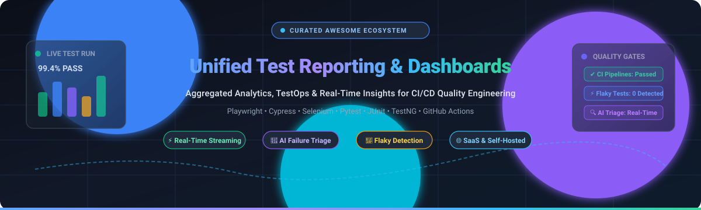

  

# 🚀 Awesome Unified Test Reporting & Dashboards

  
  
  
  
  
  

> 🌟 A curated directory of top **Unified Test Reporting**, **TestOps**, and **Automated Test Analytics Dashboards** — covering SaaS/commercial platforms and open-source software for aggregating, visualizing, and analyzing automated test results across Playwright, Cypress, Selenium, Pytest, JUnit, TestNG, and CI/CD pipelines.  
> ⭐ **Star this repository** if you find it helpful!

---

## 📋 Table of Contents

- [📈 Sector Overview & Market Dynamics](#-sector-overview--market-dynamics)
- [🟦 SaaS / Hosted Platforms](#-saas--hosted-platforms)
- [🟩 Open-Source Software](#-open-source-software)
- [📊 Comparison at a Glance](#-comparison-at-a-glance)
- [⭐ Star History](#-star-history)
- [💖 Support & Sponsorship](#-support--sponsorship)
- [🤝 Contributing](#-contributing)
- [📄 License](#-license)

---

## 📈 Sector Overview & Market Dynamics

The global software testing automation and test management software market represents an estimated **$28B–$32B** annual market in 2025–2026 (with dedicated test management & TestOps tooling capturing **$1.3B–$1.8B**), growing at a compound annual growth rate (CAGR) of 12%–15% toward an estimated **$50B+** by 2030. Rather than a winner-take-all monopoly, the sector remains **moderately fragmented**; market share is distributed across multi-billion-dollar enterprise dev/test cloud conglomerates (BrowserStack, Idera/TestRail, SmartBear, Tricentis) competing against fast-growing specialized TestOps disruptors, while modular open-source standards (such as Allure, ReportPortal, and Sorry-Cypress) dominate self-hosted CI/CD pipelines.

---

## 🟦 SaaS / Hosted Platforms

Commercial, cloud-hosted Unified Test Reporting, Test Analytics, and TestOps platforms. Sorted by company scale (valuation / annual revenue, descending).

| Platform | Company Valuation / Revenue | Starting Tier Pricing | Free Tier / Trial Limit | Key Focus & Strengths |
|---|---|---|---|---|
| **[BrowserStack Test Reporting & Analytics](https://www.browserstack.com/)** | 🏢 **$4.0B Valuation** (~$230M ARR) | 💵 **$299/user/year** (~$38/user/month equivalent, billed annually) | 🎁 **Free Trial:** Free access with limited test runs & minutes across cloud devices; separate free test management tier up to unlimited cases | Unified cross-framework test observability, flaky test detection, and AI root cause failure triage. |
| **[TestRail Reports](https://www.testrail.com/)** *(Idera, Inc.)* | 🏢 **$3.0B Parent Valuation** (~$300M+ Parent Rev; ~$10M+ TestRail) | 💵 **$22/user/month** (billed annually, Essentials plan) | 🎁 **Free Trial:** 30-day fully functional cloud free trial, no credit card required (max 5 users on Essentials tier) | Enterprise test case management, milestone progression dashboards, requirement traceability, and JUnit XML ingestion. |
| **[Katalon TestOps](https://katalon.com/testops)** | 🏢 **$36M+ ARR** (~$30M total funding raised) | 💵 **$150/seat/month** ($1,800/seat/year billed annually for Professional plan) | 🎁 **Free Forever Tier:** Free for up to 5 platform users, 3 active projects, 1 organization, and up to 2,000 monthly test results (local execution only) | Complete quality management platform combining studio test authoring, AI test generation, and executive sprint dashboards. |
| **[Allure TestOps](https://qameta.io/)** *(Qameta Software)* | 🏢 **~$5M ARR** (Privately held / bootstrapped) | 💵 **$39/user/month** (Allure TestOps Cloud) | 🎁 **Free Trial:** 14-day fully functional cloud trial, no credit card required (no perpetual free SaaS tier; self-hosted open-source Allure Report is free) | Built natively on the Allure open standard, offering centralized high-load test storage, smart rerun triggers, and historical flakiness analytics. |
| **[Calliope.pro](https://www.calliope.pro/)** *(spriteCloud)* | 🏢 **~$2M–$3M Revenue** (~15–30 employees, bootstrapped) | 💵 **€20/month** (Starter paid plans up to €250+/month for enterprise teams) | 🎁 **Free Forever Tier:** Free starter plan including up to 3 team users, 500 test results/month, and 25 test reports/month | Lightweight multi-format test results dashboard built for aggregating JSON and XML test reports across CI/CD pipelines. |

---

## 🟩 Open-Source Software

Self-hosted, community-driven Unified Test Reporting, Test Management, and TestOps tools. All listed projects provide public source code deployable on your own infrastructure, sorted by GitHub_Stars (descending).

### 1. 🏆 Allure Report
  
**Repository:** [allure-framework/allure2](https://github.com/allure-framework/allure2) | **Stack:** Java / JavaScript | **License:** Apache-2.0  
The most widely adopted open-source test reporting framework in the world. Allure transforms test execution data into interactive, visual HTML reports featuring chronological timelines, step-by-step executions, attachments (screenshots, videos, payloads), and failure categorizations. It is completely framework-agnostic with out-of-the-box adapters for 30+ testing ecosystems across Playwright, Cypress, Pytest, JUnit, TestNG, Jest, Cucumber, and NUnit.  
🎯 **Best for:** Teams wanting an industry-standard, lightweight HTML report generator integrated directly into CI/CD pipelines without operating a database.

### 2. ⚡ sorry-cypress
  
**Repository:** [sorry-cypress/sorry-cypress](https://github.com/sorry-cypress/sorry-cypress) | **Stack:** Node.js / React / MongoDB / GraphQL | **License:** MIT  
A self-hosted, open-source alternative to the proprietary Cypress Dashboard / Cypress Cloud. It enables unlimited parallel test execution, centralized test recording, screenshot/video artifact storage on S3/MinIO/GCS, flaky test detection, and pull request integration with GitHub, Slack, and Microsoft Teams.  
🎯 **Best for:** Cypress users looking to unlock free, unlimited CI test parallelization and centralized test result dashboards without vendor lock-in.

### 3. 🤖 ReportPortal
  
**Repository:** [reportportal/reportportal](https://github.com/reportportal/reportportal) | **Stack:** Java / PostgreSQL / RabbitMQ / React | **License:** Apache-2.0  
An enterprise-grade TestOps dashboard engineered for collecting, aggregating, and visualizing massive volumes of test results in real-time. It features machine-learning-assisted defect triage (classifying failures as Product Bug, Automation Bug, System Issue, or Flaky Test), historical trend widgets, customizable cross-project dashboards, and CI/CD quality gate enforcement. Easily deployed on Kubernetes or Docker Compose.  
🎯 **Best for:** Large engineering organizations running high-frequency automated test pipelines that require real-time test streaming and AI/ML-assisted failure triage.

### 4. 📋 TestLink
  
**Repository:** [TestLinkOpenSourceTRMS/testlink-code](https://github.com/TestLinkOpenSourceTRMS/testlink-code) | **Stack:** PHP / MySQL / PostgreSQL | **License:** GPL-2.0  
One of the longest-standing open-source web-based test management and reporting tools. Provides requirements tracking, test case specification, test execution tracking, milestone reporting, and assignment matrices with role-based permissions and defect tracker integration (Jira, Bugzilla, Mantis).  
🎯 **Best for:** Teams needing a proven, completely free on-premise test management system for tracking manual test cases, automated runs, and requirements traceability.

### 5. 🥝 Kiwi TCMS
  
**Repository:** [kiwitcms/Kiwi](https://github.com/kiwitcms/Kiwi) | **Stack:** Python / Django / PostgreSQL / JavaScript | **License:** GPL-2.0  
A modern, open-source test management and execution reporting system with over 2 million container downloads. Kiwi TCMS provides comprehensive test plan management, automated test execution tracking via REST/XML-RPC APIs, bug tracker integrations (GitLab, GitHub, Jira), telemetry reports, and configurable multi-tenant environments.  
🎯 **Best for:** Engineering teams looking for a modern, containerized, Python-based test management dashboard with active community maintenance and enterprise plugin support.

### 6. 🐳 Allure Docker Service
  
**Repository:** [fescobar/allure-docker-service](https://github.com/fescobar/allure-docker-service) | **Stack:** Docker / Python / JavaScript | **License:** MIT  
A containerized microservice that turns static Allure reports into a continuous live dashboard. It watches directories for incoming `allure-results` or accepts results via a REST API, automatically generating, persisting, and serving multi-project historical Allure test reports with a web UI.  
🎯 **Best for:** DevOps teams seeking a zero-friction way to convert per-run Allure results into a centralized, persistent historical reporting server with minimal overhead.

### 7. 🐙 CTRF GitHub Test Reporter
  
**Repository:** [ctrf-io/github-test-reporter](https://github.com/ctrf-io/github-test-reporter) | **Stack:** TypeScript / Node.js | **License:** MIT  
An open-source test reporting tool built around the Common Test Report Format (CTRF). It renders rich test reports, failure analysis, flaky test tracking, and duration trends directly inside GitHub Actions workflow job summaries, Pull Request comments, and CI annotations across Playwright, Cypress, Jest, Pytest, and Vitest.  
🎯 **Best for:** GitHub Actions-centric teams wanting unified PR-level test dashboards and flaky test warnings without external server hosting.

### 8. 📊 ExtentReports
  
**Repository:** [extent-framework/extentreports-java](https://github.com/extent-framework/extentreports-java) | **Stack:** Java / C# (.NET) | **License:** Apache-2.0  
A popular open-source HTML reporting library for Java and .NET test frameworks (JUnit, TestNG, NUnit). ExtentReports creates rich, interactive standalone HTML test logs featuring pie charts, historical tags, log filters, device/author metadata, and inline screenshot attachments on test failures.  
🎯 **Best for:** Java and .NET automated testing engineers who need clean, embedded HTML report generation packaged directly inside their testing code.

### 9. 🔍 Qase Open-Source Tooling & Report
  
**Repository:** [qase-tms/qase-report](https://github.com/qase-tms/qase-report) | **Stack:** TypeScript / Go / Python | **License:** MIT / Apache-2.0  
The open-source tooling, CLI, and reporting layer created by Qase. Includes open-source formatters, CI test result uploaders, and the `qase-report` tool for rendering and previewing unified test reports locally and within CI/CD pipelines.  
🎯 **Best for:** Teams integrating automated test pipelines into Qase test management while utilizing open CLI test reporting utilities.

### 10. 📈 UniTrack
  
**Repository:** [alexmond/unitrack](https://github.com/alexmond/unitrack) | **Stack:** Java / Spring Boot / Polyglot | **License:** Apache-2.0  
A self-hosted test and coverage tracking server positioned as "Allure-meets-Codecov". It tracks test trends across branches, quarantines flaky tests, enforces quality gates (minimum line coverage, max allowable coverage drop, zero new failures), clusters errors by normalized signature, and supports JVM, Go, .NET, Node.js, and Python.  
🎯 **Best for:** Polyglot software teams wanting a combined test dashboard and code coverage tracking platform in a single self-hosted server.

---

## 📊 Comparison at a Glance

| Platform / Tool | License | Hosting Mode | Real-Time Ingestion | Historical Trends | AI / Defect Triage | Best For |
|---|---|---|---|---|---|---|
| **BrowserStack** | 🏢 Commercial | Cloud (SaaS) | ✅ | ✅ | ✅ (AI root-cause) | Enterprises needing cloud device testing + unified PR observability |
| **TestRail** | 🏢 Commercial | Cloud / On-Prem | Via API/CLI | ✅ | ❌ | Teams requiring strict test case traceability & milestone audits |
| **Katalon TestOps** | 🏢 Commercial (Free Tier) | Cloud / On-Prem | ✅ | ✅ | ✅ (AI agents) | Teams using Katalon Studio needing unified sprint test analytics |
| **Allure TestOps** | 🏢 Commercial | Cloud / Self-Hosted | ✅ | ✅ | ✅ (Smart categorization) | Allure Report users upgrading to centralized enterprise TestOps |
| **Calliope.pro** | 🏢 Commercial (Free Tier) | Cloud (SaaS) | ✅ | ✅ | ❌ | Small teams seeking simple XML/JSON test result aggregation |
| **Allure Report** | 🔓 Apache-2.0 | Static / Self-Hosted | ❌ (Static) | ❌ (Per-run) | ❌ | Framework-agnostic, zero-infrastructure visual HTML reports |
| **sorry-cypress** | 🔓 MIT | Self-Hosted / Cloud | ✅ | ✅ | ❌ | Cypress users needing unlimited free parallel test dashboards |
| **ReportPortal** | 🔓 Apache-2.0 | Self-Hosted / Cloud | ✅ | ✅ | ✅ (ML auto-analysis) | Enterprise test teams requiring real-time streaming & ML triage |
| **TestLink** | 🔓 GPL-2.0 | Self-Hosted | Via API | ✅ | ❌ | Classic self-hosted test case management & test plan execution |
| **Kiwi TCMS** | 🔓 GPL-2.0 | Self-Hosted / Cloud | Via API | ✅ | ❌ | Modern containerized open-source test management for Python/DevOps |
| **Allure Docker Service**| 🔓 MIT | Self-Hosted | ✅ (Watch / API) | ✅ | ❌ | Automated live Allure dashboard server with multi-project history |
| **CTRF GitHub Reporter**| 🔓 MIT | GitHub CI-Native | ✅ (PR / Action) | ✅ | ✅ (AI summary) | GitHub Actions workflows needing native PR summaries & flaky checks |
| **ExtentReports** | 🔓 Apache-2.0 | Embedded Library | ❌ (Static) | ❌ (Per-run) | ❌ | Java and .NET test frameworks needing embedded HTML output |
| **Qase Report** | 🔓 MIT | CLI / Hybrid Cloud | Via API | ✅ | ❌ | Teams pairing open reporting adapters with Qase TestOps |
| **UniTrack** | 🔓 Apache-2.0 | Self-Hosted | ✅ (REST API) | ✅ | ✅ (MCP / Root-cause) | Teams combining automated test analytics with code coverage gates |

---

## ⭐ Star History

---

## 💖 Support & Sponsorship

Thank you so much for taking the time to explore this curated guide! Building, reviewing, and maintaining up-to-date quality assurance and TestOps references takes dedication. 

If this project has saved you hours of research or helped improve your team's test automation architecture, please consider supporting the project:
- ⭐ **Star this repository** to help others discover it on GitHub.
- 🍴 **Fork and share** it with your engineering and QA colleagues.
- ☕ **Buy me a coffee / Sponsor:** If you'd like to back ongoing open-source curation and development, consider supporting via the [GitHub Sponsors Dashboard](https://github.com/sponsors/ishandutta2007).

Your support is deeply appreciated! 🙌

---

## 🤝 Contributing

Contributions are welcome! If you know of an outstanding open-source or SaaS Unified Test Reporting or TestOps Dashboard tool that should be featured here, please feel free to submit a pull request:

1. 🍴 Fork this repository.
2. 📝 Add your tool to the appropriate table or section in alphabetical or sorted order.
3. 🔍 Include project name, official URL, tech stack, license, and key features.
4. 🚀 Open a pull request with a descriptive title.

Please ensure that open-source additions are actively maintained and that commercial tools provide transparent pricing or free tiers.

---

## 📄 License

This compilation is licensed under the [Creative Commons Zero v1.0 Universal](https://creativecommons.org/publicdomain/zero/1.0/) (CC0 1.0) Public Domain Dedication. Listed third-party tools, trademarks, and logos belong to their respective copyright holders.

---

  ⭐ <b>Found this guide helpful? Please star this repository to support continuous updates!</b> ⭐

